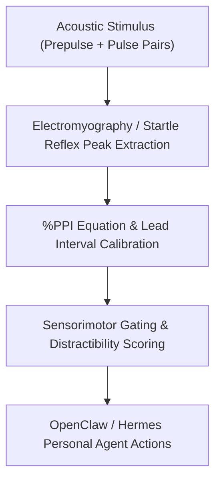

# Acoustic Startle Prepulse Inhibition (PPI) Skill

[](LICENSE)
[](https://www.python.org/)
[](requirements.txt)
[](mcp_server.py)
[](SKILL.md)

Zero-dependency sovereign personal agent skill for non-invasive evaluation of Acoustic Startle Reflex Prepulse Inhibition (%PPI), sensorimotor gating integrity, and environmental sensory overload vulnerability.



## Features
- **Deterministic Math**: Pure Python standard library implementation with zero external dependencies.
- **Neurophysiological Standard Formulas**: Implements validated prepulse startle suppression equations.
- **Cognitive Distraction Stratification**: Quantitative evaluation of sensory filtering resilience in noisy environments.
- **Model Context Protocol (MCP)**: Native JSON-RPC tool integration for LLMs and autonomous agents.

## Quickstart

```python
from client import AcousticStartlePPIClient

client = AcousticStartlePPIClient()
result = client.evaluate_prepulse_inhibition(
    pulse_alone_amplitude=135.0,
    prepulse_pulse_amplitude=38.0,
    lead_interval_ms=100.0
)
print("PPI Percentage:", result["ppi_percentage"], "%")
print("Classification:", result["classification"])
```

## License
Apache-2.0
